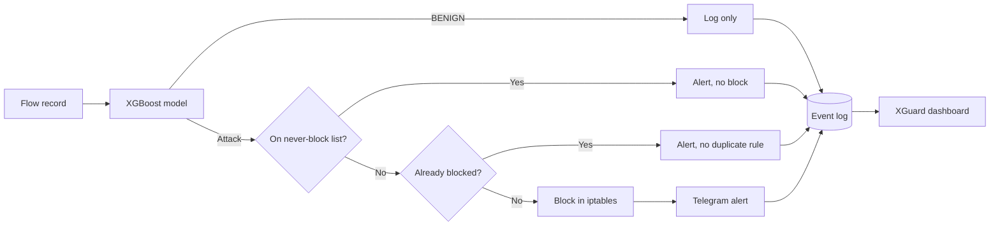
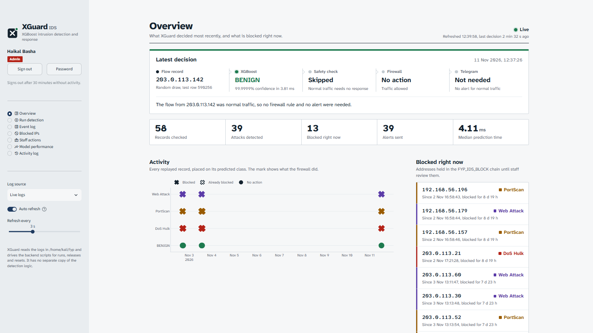
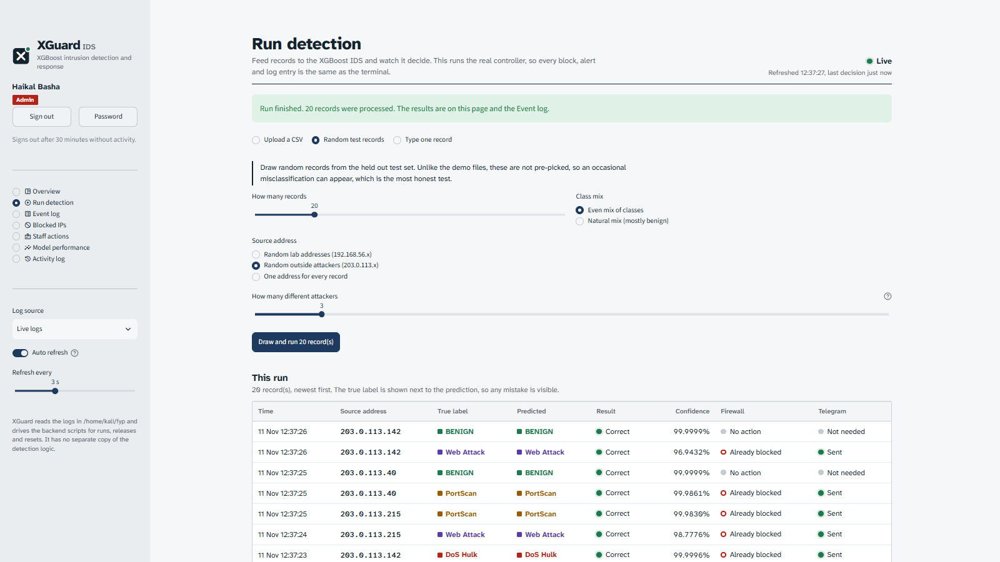
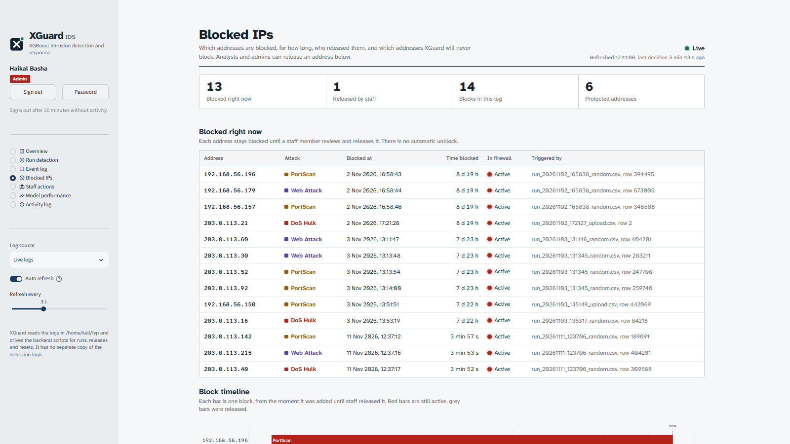
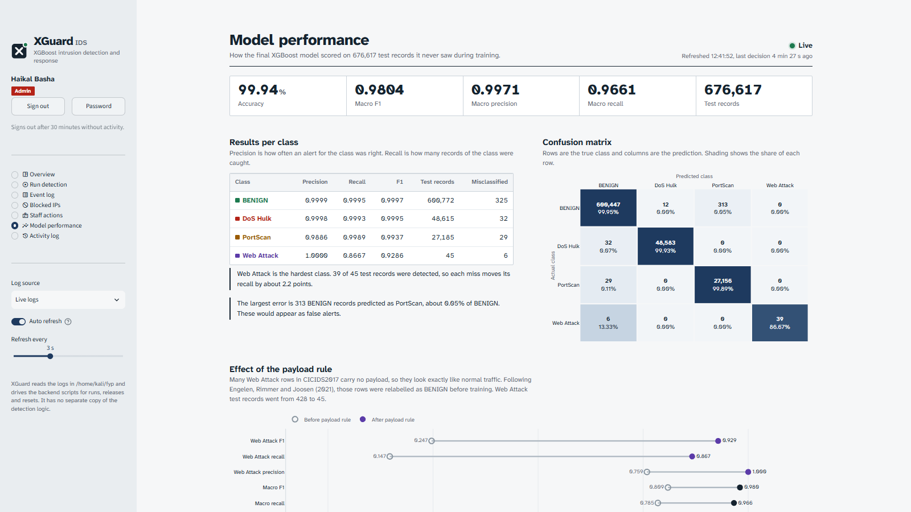

# XGuard IDS

**An intrusion detection system that classifies network flows with XGBoost, blocks attackers with iptables, alerts staff on Telegram, and gives staff a role based web control panel.**

Final year project, Bachelor of Computer Science (Hons.) Computer Networks, Universiti Teknologi MARA (UiTM), 2026.


---

## What it does

XGuard reads network flow records, predicts whether each one is normal traffic or one of three attack types, and responds automatically.

1. **Detect** An XGBoost model classifies each flow as BENIGN, DoS Hulk, PortScan or Web Attack, using 12 flow features from the CICIDS2017 dataset.
2. **Respond** If the flow is an attack, the source IP is blocked in a dedicated iptables chain (FYP_IDS_BLOCK). Blocking happens before alerting, so protection is never delayed by the network.
3. **Alert** A Telegram message tells staff what was detected, from where, and what action was taken.
4. **Review** Blocks never expire on their own. A staff member releases an address only after review, with their name and a note, and every release is logged.
5. **Control** A web dashboard lets staff watch decisions live, run detection on their own data, and manage blocks, with login and role based access.

## Results

Scores on 676,617 held out test records the model never saw during training.

| Metric | Score |
|---|---|
| Accuracy | 99.94% |
| Macro F1 | 0.9804 |
| Macro precision | 0.9971 |
| Macro recall | 0.9661 |
| Prediction time, one record | 2.65 ms mean |
| Prediction time, whole test set | 3.59 µs per record |

| Class | Precision | Recall | F1 |
|---|---|---|---|
| BENIGN | 0.9999 | 0.9995 | 0.9997 |
| DoS Hulk | 0.9998 | 0.9993 | 0.9995 |
| PortScan | 0.9886 | 0.9989 | 0.9937 |
| Web Attack | 1.0000 | 0.8667 | 0.9286 |

**The payload rule.** Many Web Attack rows in CICIDS2017 carry no payload, so they look identical to normal traffic. Following Engelen, Rimmer and Joosen (2021), those rows were relabelled as BENIGN before training. This raised Web Attack F1 from 0.247 to 0.929. Both versions of the cleaning script are kept so the comparison can be reproduced (clean_data.py is the original, clean_data_v2.py adds the payload rule).

## How it works



## The dashboard

A Streamlit control panel that drives the same backend scripts used in the terminal, so every block, alert and log entry is identical. It has no separate copy of the detection logic.

| Page | What it shows |
|---|---|
| Overview | The latest decision drawn as the real pipeline, live numbers and recent activity |
| Run detection | Upload a CSV, draw random test records, or type one record by hand |
| Event log | Every decision with filters, CSV export and per run reports |
| Blocked IPs | Current blocks, live firewall status, block history and the never-block list |
| Staff actions | The audit trail of every release |
| Model performance | Metrics, confusion matrix, payload rule effect and prediction speed |
| Activity log | Every sign in and control action, plus account management |

### Roles

| Function | Viewer | Analyst | Admin |
|---|---|---|---|
| View all pages and download reports | Yes | Yes | Yes |
| Run detection | - | Yes | Yes |
| Release a blocked IP, restore firewall blocks | - | Yes | Yes |
| Edit the never-block list, reset the demo | - | - | Yes |
| Manage accounts | - | - | Yes |

### Screenshots

| Overview | Run detection |
|---|---|
|  |  |

| Blocked IPs | Model performance |
|---|---|
|  |  |

## Security design

1. **Block before alert** so a slow or failed Telegram message never delays protection.
2. **Never-block list** so the system can never block its own addresses or gateway. Built in addresses cannot be removed from the dashboard.
3. **Least privilege** A sudoers rule lets the dashboard run only the three backend scripts as root, nothing else.
4. **Passwords** are stored as salted PBKDF2 SHA256 hashes, never as plain text.
5. **Lockout** after 5 wrong passwords, forced change of temporary passwords, and sign out after 30 minutes idle.
6. **Audit trail** Every release records a staff name and review note, and every dashboard action is logged against a person.
7. **No shell injection** Commands run as fixed argument lists, addresses are validated, and typed text is cleaned before reaching any script.

## Repository layout

```
ids/                 main IDS system
  clean_data.py      original cleaning
  clean_data_v2.py   cleaning with the payload rule
  split_data.py      70/30 stratified split with a validation set
  train_model.py     XGBoost training with grid search
  evaluate_model.py  test set evaluation
  ids_controller.py  detects, blocks and alerts
  ids_firewall.py    iptables blocking in the FYP_IDS_BLOCK chain
  telegram_alert.py  Telegram messages
  unblock_ip.py      staff release tool
  reset_demo.py      clears blocks and archives logs
  models/            trained model and its feature list
  results/           evaluation outputs
  demo/              demo records
dashboard/           XGuard control panel
```

## Running it

Built and tested on Kali Linux in VirtualBox. iptables needs root, so the IDS scripts run with sudo.

**1. Get the dataset.** Download CICIDS2017 from the Canadian Institute for Cybersecurity (link below). It is not included here because of its size and licence.

**2. Set up the IDS**

```bash
cd ids
python3 -m venv venv
venv/bin/pip install -r requirements.txt
cp config/telegram.example.json config/telegram.json   # then add your own bot token and chat ID
sudo venv/bin/python ids_controller.py demo/demo_main_2.csv
```

**3. Set up the dashboard**

```bash
cd dashboard
python3 -m venv venv
venv/bin/pip install -r requirements.txt
sudo bash setup_permissions.sh          # lets the dashboard run the three backend scripts
venv/bin/python xguard_auth.py create-admin
./run_dashboard.sh                      # then open http://localhost:8501
```

The dashboard expects the IDS folder at ~/fyp, or set XGUARD_FYP_DIR to its location.

## Limitations

These are stated openly because they matter for anyone judging the results.

1. **Replayed records, not live packets.** The model reads 12 flow features that are computed over a whole finished flow. The system replays stored CICIDS2017 records and does not capture live packets or compute features in real time.
2. **Dataset dependence.** In CICIDS2017 every DoS Hulk flow targets port 80. Changing only the destination port of a Hulk record to 443 made the model predict BENIGN, which shows the model leans on port and may not generalise to attacks it never saw in training.
3. **Lab only.** The dashboard has no HTTPS and is meant for an isolated lab network. The sudoers rule trusts scripts in a user owned folder, which would be root owned in production.

## Built with

Python, XGBoost, scikit-learn, pandas, Streamlit, Plotly, iptables, Telegram Bot API, Kali Linux, VirtualBox.

Development was assisted by AI tools (Claude by Anthropic) for parts of the code and documentation. The design decisions, testing and evaluation are my own, and I can explain every part of the system.

## References

1. Sharafaldin, I., Habibi Lashkari, A. and Ghorbani, A. A. (2018). Toward generating a new intrusion detection dataset and intrusion traffic characterization. ICISSP 2018. Dataset at https://www.unb.ca/cic/datasets/ids-2017.html
2. Engelen, G., Rimmer, V. and Joosen, W. (2021). Troubleshooting an intrusion detection dataset, the CICIDS2017 case study. IEEE Security and Privacy Workshops.
3. Chen, T. and Guestrin, C. (2016). XGBoost, a scalable tree boosting system. KDD 2016.

## Author

**Akmal Haikal Basha bin Mustafa Kamal Basha**
Bachelor of Computer Science (Hons.) Computer Networks, UiTM
GitHub [@kalbasha786](https://github.com/kalbasha786)
